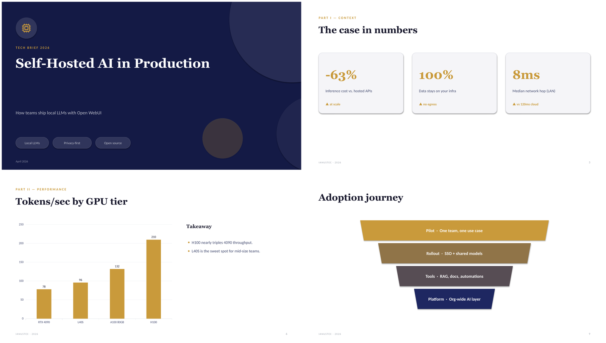
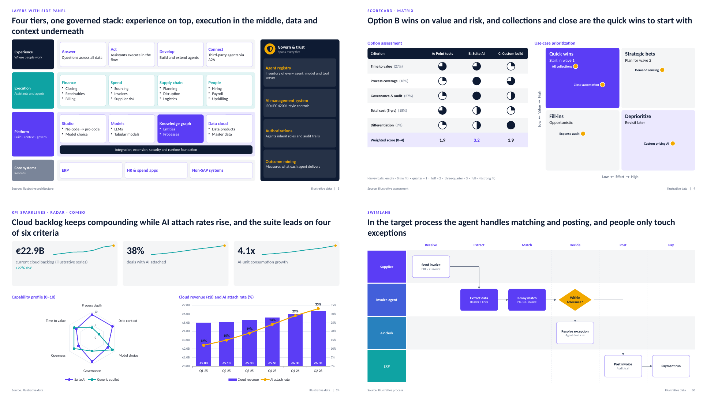
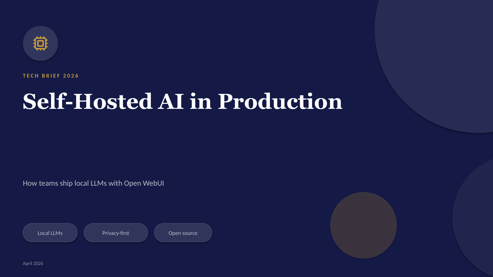
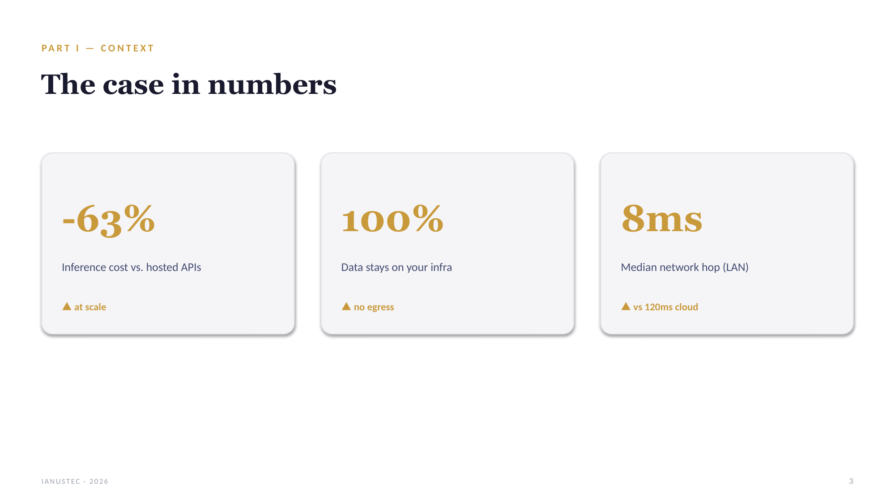
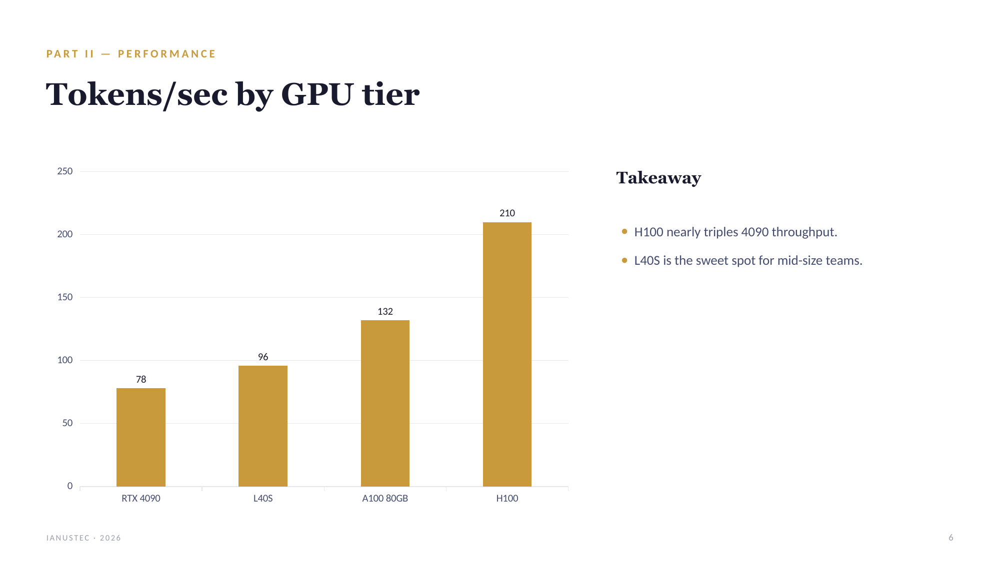
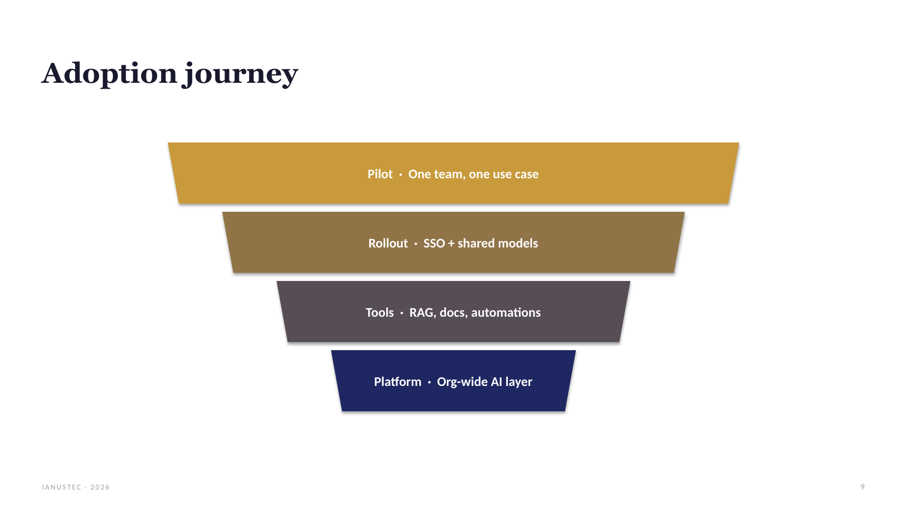

# Generate Slides — Native PPTX engine for Open WebUI

> Part of **[NEURA Office](https://github.com/ianustec/neura-office)**: native Word, PowerPoint and Excel for Open WebUI.

An [Open WebUI](https://github.com/open-webui/open-webui) **Tool** that generates
**native PowerPoint (.pptx)** presentations from a JSON spec produced by the model.

**v2.0** adds the **Deck Kit engine**: a "blocks" deck format with **44 consulting-grade
components** (KPIs with sparklines, native charts including combo, layered architectures,
Gantt with dependencies, SWOT, 2×2 matrix, Harvey-ball scorecards, waterfall, heatmaps,
RACI, swimlanes, journey maps…), **14 theme presets**, measured auto-fit text, a schema
validator that tells the model exactly what to fix, and 17 ready-made slide templates.
It runs inside the single `.py` file. You don't need Node, Docker or an extra server.
It doesn't export HTML or images: it builds the slides directly with `python-pptx`,
with a coherent visual system, layered decorative shapes, **native charts**, icons
inside circles and rich layouts.

The resulting file is saved through Open WebUI's **Files API** (with a `/cache/files`
fallback) and a clickable **download link** appears in the chat.

> License: MIT · Author: [IANUSTEC](https://ianustec.com)



*Slides generated from the example [`examples/deck.json`](examples/deck.json) → [`examples/demo_tech_deck.pptx`](examples/demo_tech_deck.pptx).*

## Features

- **v2 blocks format (Deck Kit engine)**: 44 components, 14 themes, auto-fit text, layout
  recipes, plus three new model tools: `get_deck_components`, `get_deck_template` and `validate_deck`.
  See [v2 blocks format](#v2-blocks-format-deck-kit-engine).

- **Native, editable .pptx** (text, charts and shapes are editable in PowerPoint/Keynote/LibreOffice).
- **Native Office charts**: `bar`, `line`, `area`, `pie`, `doughnut`, `radar`, `stacked_bar`.
- **~25 ready-made layouts**: cover, sections, bullets, columns/comparison, KPIs, timeline,
  process flow, icon lists, icon grids, pillars, quote, alert, tables,
  diagrams (funnel, pyramid, cycle, quadrant, bullseye) and image layouts.
- **Curated themes** + custom accent (`theme:"auto"` infers the theme from the content).
- **Lucide-style icons** bundled in the file (no network dependency for icons).
- **Optional images** from Unsplash (with a key) or generated via Open WebUI.
- **Template Mode**: build a deck by cloning shapes from a user `.pptx` template and overlaying content in the template safe zone.
- **`inspect_slides`**: JSON inventory of the template for the model: text, table and picture ids per slide, and every image inside the `.pptx` (slides, backgrounds, layout/master logos) with a `ref` the model can place on new slides.
- **Single-file**: one self-contained `.py`, ready to paste into the Tools registry.

See [CHANGELOG.md](CHANGELOG.md) for release notes.

## Requirements

- Open WebUI `>= 0.4.0`
- Python: `python-pptx`, `pillow` (declared in the frontmatter → Open WebUI installs them automatically)
- Optional: `httpx` (fetch images from URL/Unsplash)

## Installation

### Option A — from the Open WebUI community
1. Open the tool page on the Open WebUI community site.
2. Click **Get** / **Import** to your instance.

### Option B — manual
1. In your Open WebUI instance go to **Workspace → Tools → +**.
2. Paste the contents of [`generate_slides.py`](generate_slides.py).
3. Save. The declared dependencies are installed on first use.
4. Enable the tool for the model (or chat) that should use it.

## Usage

The model calls `generate_slides(content)`, where `content` is a **single JSON string**.
Minimal structure:

```json
{
  "title": "Presentation title",
  "subtitle": "Optional subtitle",
  "author": "Author / company",
  "theme": "auto",
  "footer": "Footer label",
  "slides": [
    { "layout": "cover", "title": "...", "subtitle": "...", "icon": "cpu" },
    { "layout": "kpi_row", "title": "...", "stats": [ { "value": "-40%", "label": "..." } ] }
  ]
}
```

See the full example in [`examples/deck.json`](examples/deck.json).

## v2 blocks format (Deck Kit engine)



A deck uses this engine automatically when its slides use `type` / `rows` / `blocks`
instead of `layout`. You can also force it with `"engine": "kit"`. Classic decks and
Template Mode work exactly as before.

```json
{
  "meta": { "title": "SAP Business AI", "author": "Strategy team", "footer": "Confidential" },
  "theme": "azure_corporate",
  "slides": [
    { "type": "cover", "kicker": "Executive brief", "title": "…", "subtitle": "…",
      "blocks": [ { "type": "kpis", "items": [ { "value": "50+", "label": "…", "icon": "assistant" } ] } ] },
    { "type": "content", "kicker": "How it works", "title": "<one-sentence takeaway>",
      "rows": [
        { "h": 1.15, "blocks": [ { "type": "process", "steps": [ { "icon": "chat", "title": "Intent", "text": "…" } ] } ] },
        { "h": 1.4,  "blocks": [
            { "type": "chart", "heading": "Impact (%)", "chart_type": "bar", "categories": ["A","B"],
              "series": [ { "name": "Impact", "values": [90, 50] } ], "unit": "%" },
            { "type": "cards", "columns": 2, "items": [ { "title": "…", "text": "…" } ] } ] } ],
      "source": "Publisher, date", "notes": "Speaker notes" },
    { "type": "closing", "title": "Next steps",
      "blocks": [ { "type": "checklist", "items": [ { "text": "…", "owner": "CFO", "due": "Nov 15" } ] } ] }
  ]
}
```

A content slide holds up to 4 rows, and each row holds up to 4 blocks side by side
(`h` = relative row height, `w` = relative block width, `heading` = small label above a block).

| Group | Components |
|---|---|
| Numbers | `kpis` (sparklines) · `rings` · `progress` · `callout` |
| Charts (native, editable) | `chart`: bar, column, stacked, line, area, pie, doughnut, radar, **combo** (columns + line on a 2nd axis) · `waterfall` · `bubble` · `mekko` |
| Flow and sequence | `process` · `timeline` · `chevrons` · `cycle` · `staircase` · `flow` · `swimlane` |
| Structure | `layers` (side panel) · `concentric` · `value_chain` · `hub` · `tree` · `pyramid` · `funnel` · `venn` |
| Strategy and decisions | `swot` · `matrix` · `scorecard` · `comparison` · `heatmap` · `maturity` · `risk_matrix` |
| Plan and PMO | `gantt` (milestones, dependency arrows) · `status` · `board` · `checklist` · `raci` |
| People and customers | `org_chart` · `profiles` · `persona` · `journey` |
| Text and media | `cards` · `bullets` · `table` (auto RAG colours) · `agenda` · `image` |

**Themes:** `midnight_violet` (default) · `graphite_gold` · `ocean_teal` · `forest_moss` · `crimson_navy` ·
`mono_slate` · `azure_corporate` · `emerald_finance` · `civic_navy` · `clinic_teal` · `coral_energy` ·
`royal_plum` · `print_mono` · `high_contrast`. Override any colour or font:
`{"preset": "mono_slate", "primary": "1F4E79", "accent": "FFC000", "fonts": {"head": "Calibri", "body": "Calibri"}}`.

**Tools the model gets in addition to `generate_slides`:**

| Tool | Purpose |
|---|---|
| `get_deck_components(names)` | Overview (no names) or exact fields + example per component (`"kpis,gantt"`) |
| `get_deck_template(name)` | 17 proven slide skeletons (`executive_summary`, `architecture`, `business_case`, `roadmap`, `risks`, …) or `full_deck` |
| `validate_deck(content)` | Dry run: schema errors + layout warnings, no file |

**Model guardrails built into the engine:**
- Bracket slips in long JSON (one missing or extra `]`/`}`), code fences, prose around the JSON
  and `{"deck": …}` wrappers are repaired automatically.
- Schema errors come back as a "call again" result that names the exact item
  (`slides[3].rows[1].blocks[0](chart).series[0].values: 3 values but 4 categories`).
  When that happens, no file is produced.
- Layout notes (text that had to shrink past its minimum, rows too short, blocks too narrow) are
  returned to the model with the download link so it can offer a fix.

**Images:** `image`, `profiles`, `org_chart` and `persona` accept `https://` URLs, data URIs, or a
file name in the folder set by the `kit_images_dir` valve (default `/app/backend/data/deck-images`).

**Recommended model setup:** use [`prompts/deck-builder-system-prompt.md`](prompts/deck-builder-system-prompt.md)
as the model's system prompt. Turn native function calling on and allow a large context
(32k or more). Example decks: [`examples/kit/showcase.json`](examples/kit/showcase.json) (35 slides, every component)
and [`examples/kit/sap-business-ai.json`](examples/kit/sap-business-ai.json).

### Classic customization (no template)

Works on the standard theme engine (no `reference_file_id` required):

| Field | Effect |
|---|---|
| `palette.primary`, `palette.dark`, `palette.accent`, `palette.light_accent` | Override named theme colors |
| `accent`, `primary` (top-level) | Shortcuts for accent / primary |
| `heading_font`, `body_font` | PowerPoint font names (e.g. `"Calibri"`, `"Arial"`) for titles and body text |

```json
{
  "title": "Branded deck",
  "theme": "ocean",
  "palette": { "accent": "C99A3B", "primary": "1E3A5F" },
  "heading_font": "Calibri Light",
  "body_font": "Calibri",
  "slides": [{ "layout": "title_bullets", "title": "Hello", "bullets": ["One"] }]
}
```

### Template Mode (3-step workflow)

Use this when the user attaches a **template `.pptx`** and wants the output to keep its look (backgrounds, logos, decorative shapes) while replacing slide content.

1. **Step 1 — `inspect_slides`** — Pass the Files API `file_id` (or rely on chat attachment auto-detection **only in this tool**). Returns a compact JSON for the model: per slide the text, table and picture ids with their verbatim text, and `images[]` (`ref`, size, slides, `on`). Decorations, bbox and safe zones stay server-side: decorations are cloned and safe zones applied by the tool.
2. **Step 2 — Model** — Builds the content JSON plus the **same** `reference_file_id`. Prefer per-slide **`reuse`** (`slide`, `keep_ids`, `drop_ids`, `text` from inspect shape `"id"`) when mirroring each template slide; otherwise `template_mapping` + `template_edits`.
3. **Step 3 — `generate_slides(content)`** — Re-downloads the reference, clones allowed shapes, overlays layouts in the safe zone, saves the `.pptx`. Requires admin valve **`template_mode_enabled=true`**.

**Important:** `generate_slides` does **not** infer the template from chat attachments. Only an explicit `reference_file_id` in the JSON enables Template Mode.

Example spec: [`examples/template-deck-with-reference.json`](examples/template-deck-with-reference.json). Deep dive: [`doc/template-mode-implementation-plan.md`](doc/template-mode-implementation-plan.md). Model instructions (Neura): [`doc/neura-template-mode-model-hints.md`](doc/neura-template-mode-model-hints.md).

#### Template Mode JSON fields

| Field | Description |
|---|---|
| `reference_file_id` | Files API id of the template `.pptx` |
| `slides[].reuse` | Per output slide: clone template slide index + shape ids + in-place text (see [`examples/template-reuse-slide.json`](examples/template-reuse-slide.json)). Template tables (`kind: "table"`) are refilled in place with `text["<id>"] = {"headers": [...], "rows": [[...]]}` keeping cell formatting |
| `template_mapping` | Fallback: maps layout role → reference slide index (`cover`, `section`, `content`, `closing`, `default`, …) |
| `template_edits.defaults` | Clone policy: `drop_text`, `drop_placeholders`, `drop_offslide` (conservative defaults; set `drop_text: true` only when the user wants template wording removed) |
| `template_edits.slides[]` | Per reference slide: `index` (0-based in the **template file**), `drop_ids`, optional `keep_ids` |

With **`template_mode_enabled=false`** (default), `reference_file_id` is ignored and a classic deck is generated (same behavior as v1.0.3).

### Post-generate edit (optional)

Separate from Template Mode’s 3-step workflow: after the user **opens** a deck from `generate_slides`, they may ask for small fixes (title too large, text overlap, split title vs body). Neura should call **`edit_presentation`** with a JSON `content` string — not rerun `generate_slides` for those tweaks.

Flow: user feedback → Neura → optional `inspect_slides` on the **output** file UUID → `edit_presentation` with `presentation_file_id` + `operations[]` (`set_text`, `shrink_font`, …).

Requires admin valve **`presentation_edit_enabled=true`** (default off; independent of `template_mode_enabled`). Input must be a Files API **UUID** from the last generate/edit response, not the template `reference_file_id`.

Docs: [doc/presentation-edit-implementation-plan.md](doc/presentation-edit-implementation-plan.md) · Model hints: [doc/neura-presentation-edit-hints.md](doc/neura-presentation-edit-hints.md) · Chat examples: [doc/neura-presentation-edit-chat-examples.md](doc/neura-presentation-edit-chat-examples.md).

Minimal payload shape:

```json
{ "presentation_file_id": "<uuid>", "operations": [{ "op": "set_text", "slide": 1, "shape_id": 1, "text": "..." }] }
```

v2 ops (same JSON): `enable_autofit`, `replace_text_and_fit`, `split_text` (`from_shape_id`, `to_shape_id`, `mode`), `resize_shape` (`delta_height_in`), `set_table_cell` (`row`, `col`, `text`), **`set_font_pt`** (`font_pt` or `font_pt_delta`). **`shrink_font`** optional `"mode"`: `fit` (default), `to_min`, `target` (+ `target_pt`). JSON `"slide"` uses PowerPoint numbering when `EDIT_SLIDE_INDEX_ORIGIN=1` in `generate_slides.py`.

### Themes
`auto` (default, inferred from content) · `midnight` · `forest` · `ocean` · `coral`
· `terracotta` · `teal` · `berry` · `sage` · `cherry` · `charcoal` · `slate`.
You can force the accent with `"accent": "#C99A3B"`.

### Available layouts (main fields)

| Layout | Main fields |
|---|---|
| `cover` | `title`, `subtitle`, `author`, `eyebrow`, `icon`, `date`, `chips[]` |
| `section` | `number` (`"01"`), `eyebrow`, `title`, `lead` |
| `title_bullets` | `title`, `eyebrow`, `bullets[]` |
| `title_body` | `title`, `eyebrow`, `body` (paragraphs separated by `\n`) |
| `two_column_text` / `comparison_two` | `left{}`, `right{}` or `columns[]` (`heading`, `icon`, `points[]`, `highlight`, `badge`) |
| `kpi_row` | `stats[]` with `{value, label, change}` |
| `timeline_horizontal` / `process_flow` | `steps[]` with `{when, title, description}` |
| `icon_list_vertical` | `items[]` with `{icon, title, description}` |
| `icon_grid_2x2` / `icon_grid_3` / `pillars` | `items[]` with `{icon, title, description}` |
| `chart` | `chart_type`, `labels[]`, `values[]` or `datasets[]{label,data[]}`, `insight[]` |
| `funnel` / `pyramid` / `cycle` / `quadrant` / `bullseye` | `nodes[]` with `{label, description}` |
| `quote` | `quote`, `author`, `role` |
| `alert` | `title`, `level` (`info`\|`tip`\|`warning`\|`danger`), `body` or `bullets[]` |
| `table` | `headers[]`, `rows[]` |
| `text_image_right` / `image_left_text_right` | `title`, `bullets[]`/`body`, `image_hint` or `image_url` or `base64` |
| `image_full_caption` | `title`, `subtitle`, `image_hint`/`image_url` |
| `closing` | `title`, `eyebrow`, `takeaways[]`, `contact` |

## Screenshots

| Cover | KPI row |
|---|---|
|  |  |
| **Native chart** | **Funnel** |
|  |  |

## Valves (configuration)

| Valve | Default | Description |
|---|---|---|
| `default_theme` | `auto` | Default theme when the spec doesn't set one |
| `footer_label` | `""` | Default footer (overridden by `spec.footer`) |
| `unsplash_access_key` | `""` | Unsplash key for stock images (optional) |
| `image_generation` | `false` | Enable AI image generation via Open WebUI |
| `max_image_px` | `1600` | Maximum image width |
| `emit_status` | `true` | Emit status events in chat |
| `pptx_export_dir` | `/app/backend/data/cache/files` | Fallback directory for saving |
| `template_mode_enabled` | `false` | Enable reference download + template clone in `generate_slides` |
| `inspect_slides_enabled` | `true` | Allow the `inspect_slides` tool |
| `inspect_extract_images` | `true` | Upload the template images to the Files API cache on inspect (`images[]` is returned either way) |
| `template_strict_mode` | `false` | Fail generate when reference `safe_zone` is not `computed` or is too small |
| `presentation_edit_enabled` | `false` | Enable `edit_presentation` (post-generate fixes on an existing output UUID) |
| `presentation_edit_min_font_pt` | `14` | Floor for `shrink_font` when op omits `min_pt` |
| `presentation_edit_shrink_step_pt` | `2` | Step for `shrink_font` when op omits `step_pt` |
| `presentation_edit_progress_every` | `5` | Emit progress every N ops (0 = off) |
| `presentation_edit_warn_noop` | `false` | Status hint when all ops complete but none mutated the deck |
| `kit_engine_enabled` | `true` | Use the v2 Deck Kit engine for decks in the blocks format |
| `kit_default_theme` | `midnight_violet` | Theme for v2 decks that don't set one |
| `kit_images_dir` | `/app/backend/data/deck-images` | Folder for logos/photos referenced by file name in v2 decks |
| `kit_max_warnings` | `12` | Layout notes returned to the model after a v2 render (0 = none) |

### Roadmap (Fase 8+)

Deferred post-v1: auto-inject inspect on `.pptx` upload (Open WebUI/Neura integration), optional inspect thumbnails, PNG/JPG background-only templates.

### Admin notes (Neura pilot)

- Keep **`template_mode_enabled=false`** on customer instances until Template Mode is explicitly rolled out.
- Enable **`template_mode_enabled=true`** only on internal pilot workspaces.
- **Presentation Edit:** keep **`presentation_edit_enabled=false`** by default; enable **`presentation_edit_enabled=true`** only on internal pilot workspaces where post-generate fixes are tested. Independent of template mode. Rollout checklist and log monitoring: [doc/neura-presentation-edit-hints.md — Rollout pilot Neura](doc/neura-presentation-edit-hints.md#rollout-pilot-neura-admin--ops).
- After deploy: **Workspace → Tools** → paste the updated [`generate_slides.py`](generate_slides.py) and save (same Files API workflow as v1.0.3).
- **Rollback:** turn the valve off instantly (`template_mode_enabled` and/or `presentation_edit_enabled`), or pin the previous tool version.

## How it works

1. For a custom template, the model may call **`inspect_slides`** first, then **`generate_slides`** with the same `reference_file_id`.
2. The model produces the JSON spec and calls `generate_slides` (classic or template path).
3. The engine resolves theme/accent, prefetches images (if any image layouts are present),
   and for each slide invokes the corresponding layout renderer (template path clones reference shapes first).
4. Shapes, text and charts are written as native OOXML objects.
5. The `.pptx` is saved via the Files API (fallback `/cache/files`) and the link is returned in chat.

## Local development / testing

Requires `python-pptx` and (optionally) `pillow`/`httpx`:

```bash
pip install -r examples/requirements-dev.txt httpx
python examples/build.py              # → examples/demo_tech_deck.pptx
python examples/check_baseline.py     # NF5 golden regression smoke
python examples/fixtures/build_fixtures.py   # template-mode dev fixtures
python examples/parse_template_fixtures.py   # Fase 1 template parse smoke
python examples/inspect_template_fixtures.py # Fase 2 inspect JSON (offline)
python examples/inspect_extract_media_fixtures.py  # Fase 3.1 media extract (offline)
python examples/inspect_shape_kinds.py           # Fase 3.2 kind + cloneable (offline)
python examples/inspect_online_templates.py  # real Slidesgo decks in doc/online_templates/
python examples/clone_template_fixture.py    # Fase 3 clone smoke → examples/output/
python examples/generate_slides_async_smoke.py   # NF9 / NF5 / F9 / F10 async smoke
python examples/template_mode_nf6_15_slides.py # NF6: 15-slide template deck
python examples/run_production_checks.py       # full local battery
```

Optional: open `examples/output/clone_corners.pptx` in LibreOffice for a visual check.

`inspect_slides` in Open WebUI needs the Files API runtime; the scripts above test parse/JSON locally.

See [`examples/fixtures/README.md`](examples/fixtures/README.md) for fixture types.
Local dev was verified with **Python 3.11** (Docker `python:3.11-slim`) and pinned deps in `examples/requirements-dev.txt`. Record the Open WebUI Neura container Python version on deploy (≥3.10).

The file is designed to run inside Open WebUI: the `open_webui.*` imports are optional
and the tool degrades gracefully when they're missing (handy for isolated render tests).

## Contributing

Issues and PRs welcome. Please keep the file **single-file** and free of mandatory
network dependencies for the core features.

## License

[MIT](LICENSE) © IANUSTEC
